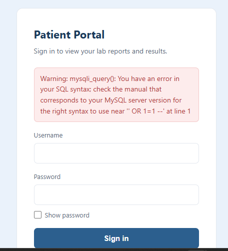
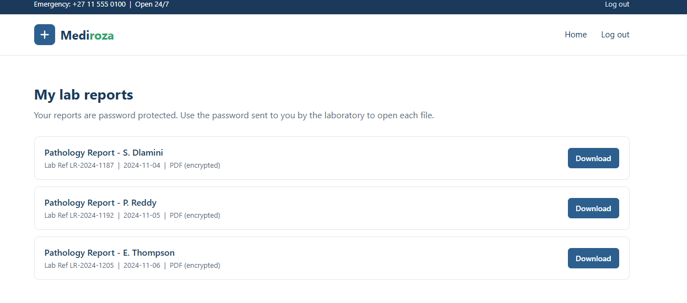
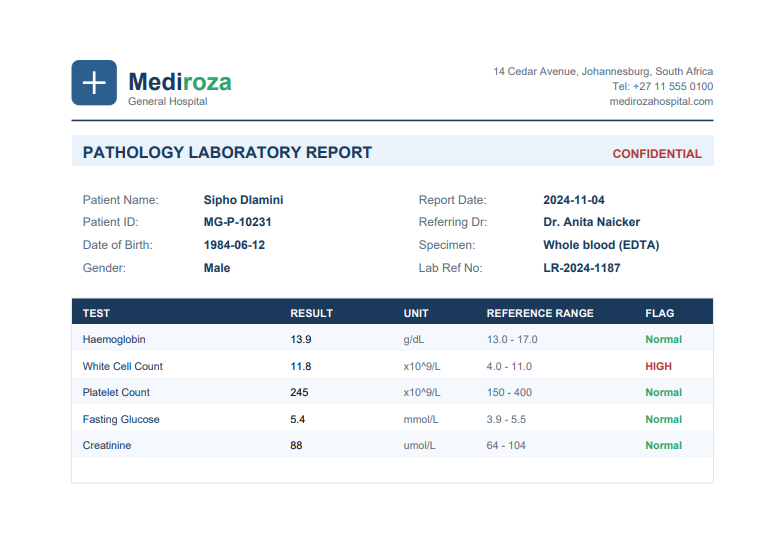
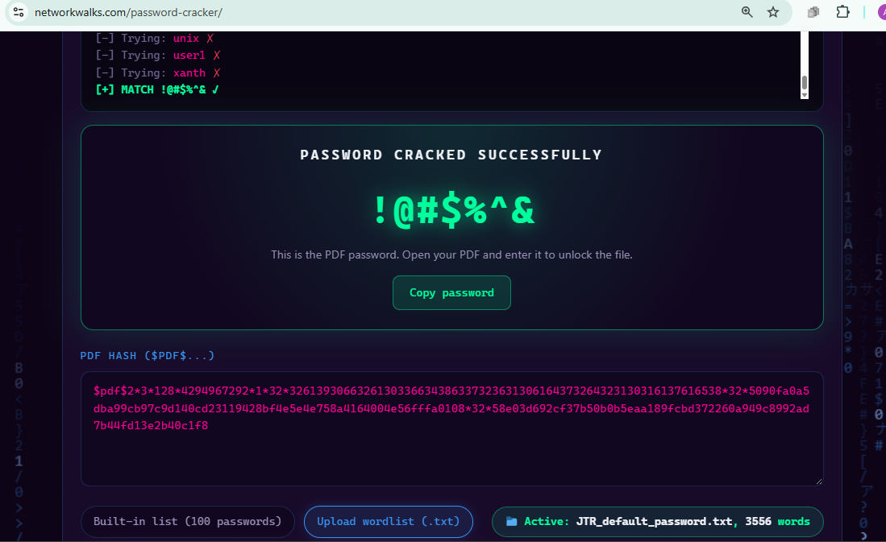
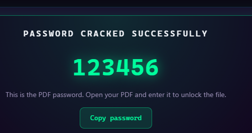
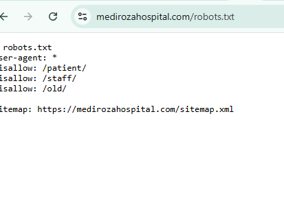
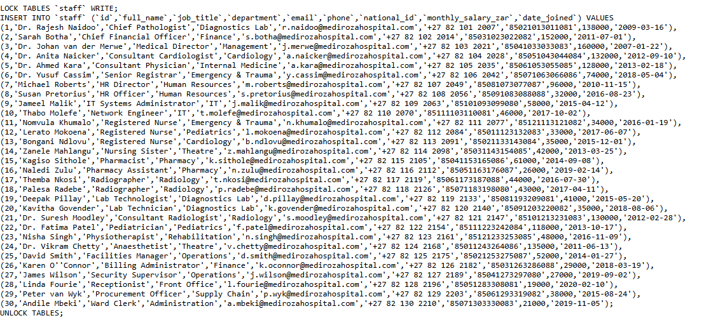
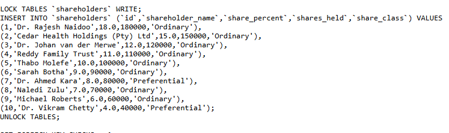

# Penetration Testing Report — Mediroza Hospital (`medirozahospital.com`)

| Assessment Metadata | Details |
| :--- | :--- |
| **Target** | `https://medirozahospital.com` |
| **Assessment Type** | Authorized Black-Box Web Application Assessment (M1–M4) |
| **Cohort / Lab** | Networkwalks Academy — Batch B084 (Week 4 Lab) |
| **Date** | November 26, 2026 |
| **Author** | Benjamin O. Ajayi |

---

## Authorization & Scope

This security assessment was conducted within the authorized **Networkwalks Academy (Batch B084 — Week 4)** laboratory environment targeting `https://medirozahospital.com`.

* **Authorization:** Testing was authorized under the Week 4 lab scope to evaluate reconnaissance exposure, backup/directory disclosure, SQL injection and authentication bypass, offline PDF password recovery, and document metadata leakage.
* **Rules of Engagement & Data Hygiene:** Testing stayed within lab scope without intentional disruption. Sensitive artifacts (`mediroza_db_backup_2019.sql` and downloaded/unlocked patient PDF reports under `reports/*.pdf`)

---

## Executive Summary

A black-box security assessment of `medirozahospital.com` a direct attack chain from initial path discovery to sensitive organizational and patient lab records.

First, i tried login to the patient portal so i tried (' OR 1=1 --) it returned error then i tried (Admin' --) and it entered. secondly, after gaining access to the patient portal i saw three lab reports (`LR-2024-1187`, `LR-2024-1192`, `LR-2024-1205`) download those locked pdf files which i cracked with Networkwalks password cracker by uploading JTR-default-password.txt to the machine which cracked all three weak PDF passwords (`123456`, `password`, `!@#$%^&`) I tried using Johnny but `johnny` returned `No password hashes loaded`, then i loaded`https://medirozahospital.com/robots.txt` revealed restricted directories (`/patient/`, `/staff/`, and `/old/`), and directory listing on `/old/` exposed `mediroza_db_backup_2019.sql` containing `30` `staff` rows and `10` `shareholders` rows. 

---

## Findings & Risk Summary

| # | Finding | Target / Artifact | Severity | Summary of Impact |
| :--- | :--- | :--- | :--- | :--- |
| **F-01** | SQL Injection (`CWE-89`), Verbose Error Disclosure (`CWE-209`), & Auth Bypass | `/patient/login.php`/patient/download.php` | **Critical** | SQL errors shown in `' OR 1=1 -- ; `admin'-- ` bypassed login, exposing lab reports and PDF downloads. |
| **F-02** | Directory Listing & Exposed SQL Backup (`mediroza_hr`) | `/robots.txt`, `/old/`, `/old/mediroza_db_backup_2019.sql` | **Critical** | `robots.txt` referenced `/old/`; directory indexing exposed `mediroza_db_backup_2019.sql` with `30` `staff` and `10` `shareholders` records. |
| **F-03** | Weak PDF Encryption Passwords & Offline Cracking | `patient_report_1.pdf`–`patient_report_3.pdf` | **High** | `john` found no hashes; `pikepdf` + `Networkwalks password cracker` cracked `123456`, `password`, and `!@#$%^&` and unlocked all three PDFs. |
| **F-04** | Access & Error Handling Asymmetry | `/patient/*`, `/staff/login.php` | **Low–Medium** | Unauthenticated `portal.php`/`download.php` returned `302` to `login.php`; `/staff/login.php` returned a generic invalid-login alert without SQL errors. |

---

## Detailed Walkthrough & Evidence

### 1. SQL Injection & Patient Portal Authentication Bypass (`F-01`,)

I tried login into patient portal first by inputting (' OR 1=1 --) which gives SQL syntax errors.

Supplying `admin'-- ` on `/patient/login.php` bypassed authentication.

Inside `/patient/portal.php`, lab reports `LR-2024-1187`, `LR-2024-1192`, and `LR-2024-1205` were visible, and `/patient/download.php` returned PDF responses.

### 2. Offline PDF Password Cracking & Metadata Analysis (`F-03`, `F-04`)

After downloading `patient_report_1.pdf`, `patient_report_2.pdf`, and `patient_report_3.pdf`, running `john` returned `No password hashes loaded` (`W4_11.png`).

After hashing those pdf file separately by Networkwalks hash calculator then Running JTR-default-password.txt in `Networkwalks password cracker` cracked all three passwords—`123456`, `password`, and `!@#$%^&`.

### 3. Reconnaissance & Exposed Legacy Backup (`F-02`)

Checking `https://medirozahospital.com/robots.txt` disclosed `Disallow` entries for `/patient/`, `/staff/`, and `/old/`.

Navigating to `/old/` showed LiteSpeed directory listing enabled and exposed `mediroza_db_backup_2019.sql`, captured in `w4_2.png`.

Inspecting `mediroza_db_backup_2019.sql` (target database `mediroza_hr`) confirmed `30` rows in the `staff` table (`w4_3.png`) and `10` rows in the `shareholders` table (`w4_4.png`).

---

## Remediation

1. **Use Prepared Statements & Suppress Verbose Errors (`F-01`):** Replace string-concatenated `mysqli_query()` calls with parameterized queries (`prepare` / `bind_param`), verify credentials with `password_verify()`, and disable `display_errors` in production.

2. **Remove Exposed Backups & Disable Directory Listing (`F-02`):** Delete `mediroza_db_backup_2019.sql` from `/old/`, disable directory indexing (`Options -Indexes`), store backups outside the web root, and rotate exposed credentials or identifiers.

3. **Use Strong Passwords, Enforce Access Checks, & Scrub Metadata (`F-03`, `F-04`):** Avoid weak passwords (`123456`, `password`, `!@#$%^&`), enforce strict session and ownership checks on `/patient/download.php`, and remove `Author` and `Comments` metadata before distributing PDFs.
